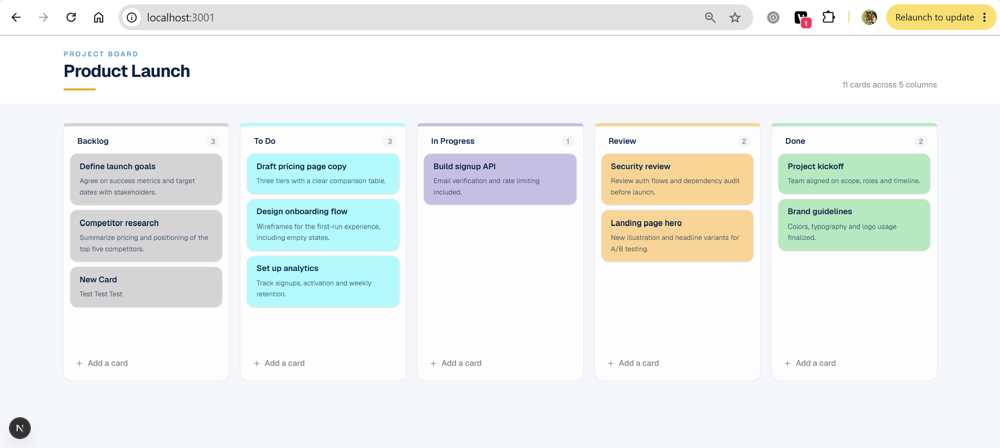

# Kanban Board

A single-board Kanban app built with Next.js, Tailwind CSS and dnd-kit. Five renamable columns, cards with a title and details, drag and drop, add and delete. No persistence: reloading restores the sample data.



## Run

```
cd frontend
npm install
npm run dev
```

Open http://localhost:3000 (or pass `-- --port 3001` if 3000 is taken).

## Test

```
npm test                         # unit and component tests (Vitest)
npx playwright install chromium  # first time only
npm run test:e2e                 # integration tests (Playwright, port 3001)
```

See [docs/PLAN.md](docs/PLAN.md) for the build plan.
